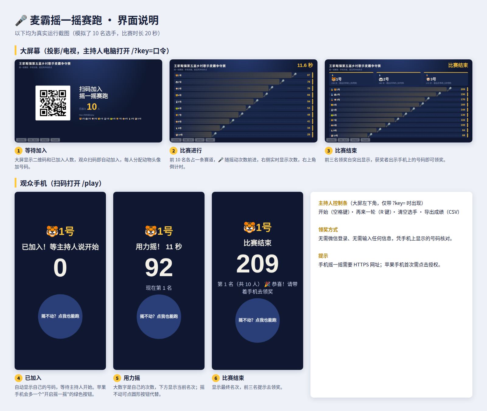

# 🎤 麦霸摇一摇赛跑

适用于线下活动大屏幕互动的"摇一摇赛跑"小游戏：观众**扫码即参加**（无需登录、无需填写任何信息），用力摇手机，大屏幕上 🎤 实时赛跑，前三名当场揭晓。

最初为"乡村歌手麦霸争夺赛"现场（约 200 人）而做，也适合年会、庙会、校园活动等场合。



## 特点

- **扫码就玩**：不用微信登录，不用输入昵称或手机号。系统自动分配"动物头像 + 号码"（如 🐯37号），适合老人和小孩。
- **大屏实时赛跑**：前 10 名各一条赛道，倒计时、次数、领奖台一应俱全。
- **领奖不靠登录**：获奖者出示手机上的号码，与大屏核对即可。
- **主持人一键控制**：空格开始、R 键再来一轮，可清空选手、导出成绩（CSV）。
- **摇不动也能玩**：手机页面带"点我也能跑"大按钮，兼容不支持摇动传感器的情况。
- **基本防作弊**：服务端限制每人每秒最多计 12 次。
- **零依赖**：服务端只用 Node.js 自带模块，二维码也内置，不依赖外网 CDN。

## 工作原理

```
观众手机 (/play) ──POST 摇动次数──▶  Node.js 服务 (server.js)  ──SSE 实时推送──▶ 大屏幕 (/)
                                       内存中保存选手与排名
```

比赛流程：等待加入 → 3 秒倒计时 → 比赛（默认 20 秒）→ 结束出榜。

## 快速试玩（本机）

需要 [Node.js](https://nodejs.org/) 16 或以上。

```bash
git clone <你的仓库地址> shake-race
cd shake-race
node server.js
```

浏览器打开 `http://localhost:3000/?key=1234` 即为大屏幕，终端里会打印手机访问地址（同一 Wi-Fi 下用手机扫码）。

> ⚠️ **手机的"摇一摇"传感器要求网页使用 HTTPS**（iOS 和安卓浏览器的限制）。本机 http 地址下，手机只能用"点我也能跑"按钮。要真正摇手机，请按下文部署到带 HTTPS 的服务器。

## 配置项（环境变量）

| 变量 | 默认值 | 说明 |
| --- | --- | --- |
| `ADMIN_KEY` | `1234` | 主持人口令，大屏地址里的 `?key=` 要与它一致。**部署前务必修改** |
| `DURATION` | `20` | 比赛时长（秒） |
| `PORT` | `3000` | 监听端口 |
| `HOST` | `0.0.0.0` | 监听地址；放在 nginx 后面时可设为 `127.0.0.1` |

修改活动标题：编辑 `screen.html` 中的 `<h1>`。

## 部署到服务器

前提：一台云服务器 + 一个域名（用于 HTTPS）。

### 关于服务器位置与备案

- 服务器在**中国大陆**：域名需先完成 ICP 备案，否则云厂商会拦截 80/443 端口。备案耗时由管局审核决定，请提前办理。
- 服务器在**香港或海外**：通常无需 ICP 备案，当天即可使用；但网站若可在大陆访问，部分云厂商要求另办公安联网备案，具体以你所用云厂商的说明为准。
- 活动时间紧时，推荐香港节点。

### 方式一：1Panel

本程序带有后端，**不能**创建"静态网站"，要用"运行环境"。

1. **上传代码**：在 1Panel 文件管理中，把仓库内容放到 `/opt/shake-race`（该目录下应直接能看到 `server.js` 和 `package.json`）。
2. **创建运行环境**：进入 网站 → 运行环境 → 创建运行环境：
   - 应用：Node.js（选择一个版本，建议长期支持版）
   - 源码目录：`/opt/shake-race`
   - 启动命令：选择 `start`（会显示 `node server.js`）
   - 应用端口：`3000`，外部映射端口：`3000`
   - **端口外部访问：建议关闭**（我们通过域名访问，无需把 3000 端口暴露在公网）
   - 环境变量：添加 `ADMIN_KEY=你自己的口令`（**不要**设置 `HOST`）
3. **创建网站**：网站 → 创建网站 → 选择"运行环境"，填写域名，选择上一步创建的环境与端口。
4. **开启 HTTPS**：在该网站的 HTTPS 设置中申请 Let's Encrypt 证书（需域名已解析到本机）。
5. 云服务器安全组放行 **80** 和 **443** 端口。

完成后访问 `https://你的域名/?key=你的口令` 即为大屏幕。

> 1Panel 各版本界面文字可能略有差异，以实际界面为准。

### 方式二：Linux 服务器（systemd + nginx）

以 Ubuntu 为例：

```bash
# 1. 安装依赖
sudo apt update && sudo apt install -y nginx certbot python3-certbot-nginx
curl -fsSL https://deb.nodesource.com/setup_20.x | sudo -E bash - && sudo apt install -y nodejs

# 2. 放置代码
sudo git clone <你的仓库地址> /opt/shake-race

# 3. 启动服务（先编辑 deploy/shake-race.service 里的 ADMIN_KEY）
sudo cp /opt/shake-race/deploy/shake-race.service /etc/systemd/system/
sudo systemctl daemon-reload && sudo systemctl enable --now shake-race

# 4. 配置 nginx（先把 deploy/nginx.conf 里的 YOUR_DOMAIN 换成你的域名）
sudo cp /opt/shake-race/deploy/nginx.conf /etc/nginx/conf.d/shake.conf
sudo nginx -t && sudo systemctl reload nginx

# 5. 申请 HTTPS 证书
sudo certbot --nginx -d 你的域名
```

记得先把域名解析到服务器，并在安全组放行 80 / 443 端口。排错：`sudo journalctl -u shake-race -f`。

## 使用方法

1. 大屏幕电脑打开 `https://你的域名/?key=你的口令`，全屏显示。
2. 观众扫屏幕上的二维码加入。
3. 主持人按**空格键**开始（3 秒倒计时后比赛 20 秒），按 **R** 再来一轮；屏幕左下角也有对应按钮。
4. 比赛结束后，前三名凭手机上的号码领奖；需要名单可点"导出成绩"。

## 现场须知

- **提前用现场手机网络（4G/5G）实测一轮**，最好找几十人同时试一次，确认网络和带宽够用。
- **苹果手机**首次需点页面上的绿色按钮并允许"运动与方向"访问，否则无法摇动。
- **微信内置浏览器**在部分手机上可能不响应摇动，可改用"点我也能跑"按钮，或用手机自带浏览器打开。
- **选手与成绩保存在服务内存中**：活动期间不要重启服务或重新部署，否则选手需要重新扫码加入。
- 同一部手机刷新或掉线重连，号码和成绩保留；换浏览器或清除浏览数据会获得新号码。
- 大屏地址里的 `?key=` 口令会出现在网址中，请勿对观众展示主持人页面的地址栏。

## 项目结构

```
├── server.js            # 服务端：状态、排名、实时推送（仅用 Node.js 内置模块）
├── screen.html          # 大屏幕页面（/）
├── play.html            # 观众手机页面（/play）
├── qr.js                # 内置二维码生成库（第三方，见下）
├── package.json         # 提供 npm start，供 1Panel 等面板读取
├── deploy/              # nginx 配置与 systemd 服务文件
├── docs/interface.png   # 界面说明图
├── licenses/            # 第三方许可证全文
├── LICENSE              # 本项目许可证（MIT）
└── THIRD_PARTY_NOTICES.md
```

## 许可证

本项目以 [MIT 许可证](LICENSE) 发布。

`qr.js` 包含第三方开源代码（qrcode-generator，MIT；经 qrcode-terminal，Apache-2.0），详见 [THIRD_PARTY_NOTICES.md](THIRD_PARTY_NOTICES.md)。
